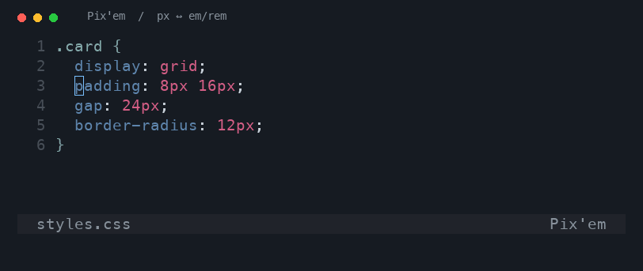

# Pix'em

A Neovim plugin for converting between **px** and **em**/**rem** units, directly in your buffer.



- [Installation](#installation)
- [Configuration](#configuration)
- [Usage](#usage)
- [Mappings](#mappings)
- [Testing](#testing)

## Installation

Using [lazy.nvim](https://github.com/folke/lazy.nvim) drop the following into your config, or do the equivalent for your plugin manager of choice:

```lua
{
    "gadkadosh/pixem.nvim",
    config = function()
        require("pixem").setup()
    end
}
```

## Configuration

Pass options to `setup()` to customize the conversion. The defaults are:

```lua
require("pixem").setup({
    -- Font size in pixels used for conversions
    root_font_size = 16,
    -- Convert px to rem; set to false to convert px to em
    use_rem = true,
})
```

Both `em` and `rem` use this fixed font size; the plugin does not calculate font sizes from CSS.

## Usage

- `:Pixem` converts values on the current line from px to em/rem or back to px.
- `:10,20Pixem` converts lines 10–20.
- `:%Pixem` converts the whole buffer.
- In Visual mode, select lines and run `:Pixem` to convert that line range.

You can also call `require("pixem").run_line()` from Lua to convert the current line.

After a conversion, `.` repeats at the current cursor, using the same number of lines (up to the end of the buffer). It toggles units again, so repeating without moving converts the values back. This works with both `:Pixem` and Lua mappings, without extra dependencies.

If the target contains mixed units, Pix'em tries to use the unit under the cursor to choose which values to convert throughout the target lines. If it cannot identify a single unit, nothing is changed.

## Mappings

The plugin does not set a mapping for you. You can easily add a mapping to your configuration:

```lua
vim.keymap.set("n", "<leader>p", require("pixem").run_line, { desc = "Convert px ↔ em/rem" })
```

## Testing

With Neovim and Make installed, run this once from the repository root to install the test dependency in a sibling directory:

```sh
git clone --depth 1 https://github.com/nvim-lua/plenary.nvim ../plenary.nvim
```

Then run the tests from the repository root:

```sh
make test
```
